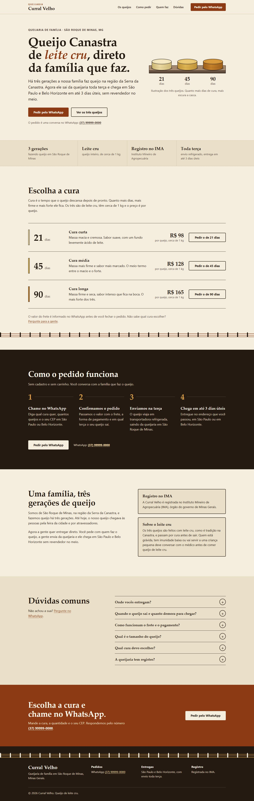
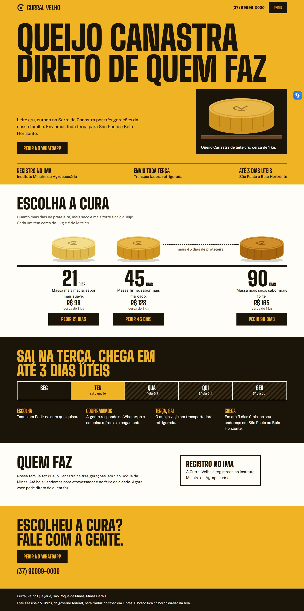
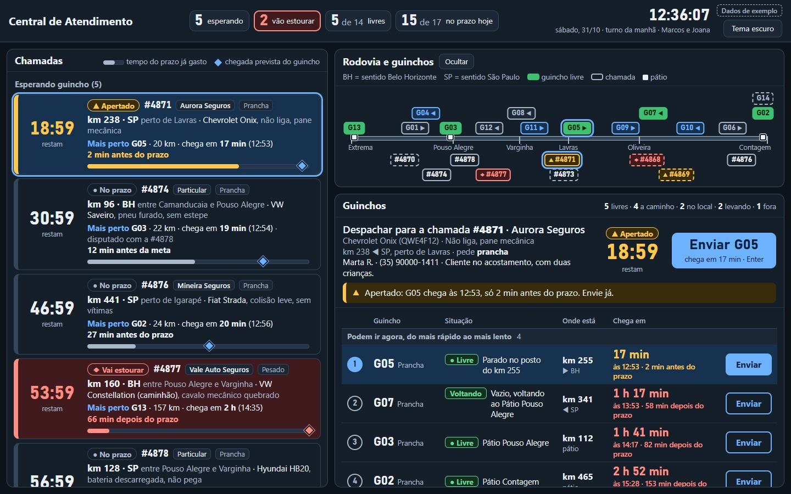
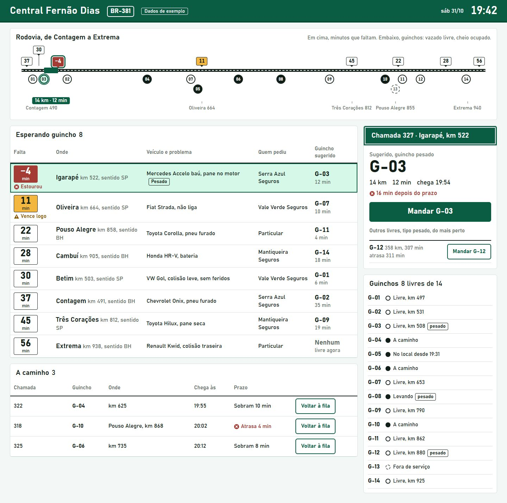

# Auditoria do kit como diretor de design: 31/10/2026

Versão auditada: branch `versao-3.1.0`, commit `91897be`, skill 3.1.0. Nada do kit foi alterado. Caminhos como `SKILL.md:62` são relativos a `skill/kit-frontend/`. Caminhos como `queijaria/com-kit/design.md:91` são relativos a esta pasta.

## 1. Veredito

**Não.** Com o kit, o mesmo agente entregou melhor nos dois briefs, no julgamento cego: margem clara na queijaria, leve na central de guincho. O juiz, que é um LLM, pediu ajustes nas duas; o dono aprovou as duas como estão, mas sabendo a origem. Foi uma rodada por brief, e a repetição não foi provada. Sem texto, a queijaria com kit foi lida como empresa financeira. Uma tela reprovada como mediana passa com 0 falhas, e nada obriga a refazer. O kit melhora execução e piso; não garante mensagem nem julgamento.

## 2. Comparação com e sem o kit

### Como foi feito

- **Geração:** quatro subagentes novos, Sonnet 5.5, um de cada vez, em pastas próprias. As duas com kit tinham a instalação real (`kit instalar`). Os quatro receberam o mesmo texto, com "decide você e segue". Pedir só ao lado com kit daria ao outro um motivo para parar e perguntar.
- **Isolamento:** o transcript dos dois agentes sem kit mostra 0 leituras fora da pasta. O prefixo de contexto da queijaria sem kit, único que existia para conferir, não cita o kit.
- **Juízo:** um agente novo, Opus 5.5, viu capturas com rótulos sorteados (K, M, R, T) e não sabia que existia um kit. Parecer completo em [parecer-cego.md](parecer-cego.md); sorteio em `chave-do-sorteio.json`.
- **Leitura sem nome:** dois agentes novos, Sonnet 5.5: [leitura-cega-1.md](leitura-cega-1.md) e [leitura-cega-2.md](leitura-cega-2.md).
- **Modelo:** usei Sonnet na geração por ser um "agente comum" e pelo limite de uso. Um agente Opus poderia dar outro resultado.

### Resultado

| | Queijaria sem kit (K) | Queijaria com kit (M) | Guincho sem kit (R) | Guincho com kit (T) |
| --- | --- | --- | --- | --- |
| Veredito do juiz | **Reprovaria** | Aprovaria com ajustes pequenos | **Reprovaria** | Aprovaria com ajustes pequenos |
| Margem no par | | M, clara | | T, leve |
| Verificador, mesma régua | 0 falhas, 3 avisos, saída 0 | 0 falhas, 1 aviso, saída 0 | **4 falhas**, 12 avisos, saída 1 | 0 falhas, 3 avisos, saída 0 |
| Palavras na primeira dobra | 128 | 0 (erro de medida, achado G6) | 472 | 237 |
| Tamanhos de letra distintos | 15 | 15 | 19 | 13 |
| Fonte | Do sistema | Servida pelo projeto | Do sistema | Do sistema |
| Tokens de saída | 72 mil | 141 mil | 168 mil | 152 mil |
| Maior contexto | 161 mil | 316 mil | 262 mil | 302 mil |
| Tempo | 594 s | 1.394 s | 1.432 s | 1.517 s |

"Mesma régua" é `verificar.mjs` sem `DESIGN.md` nem `PRODUTO.md` nas quatro. Com os próprios arquivos, M dá 0 e 1, e T dá 0 e 2.

### Queijaria

Sem kit (K): "Correta e sem graça", nas palavras do juiz. É creme, serifa e ferrugem, a receita inteira de "artesanal de família".

Com kit (M): tem ideia própria (eixo da cura, calendário da terça, carimbo no queijo), com defeitos de acabamento e de mensagem.

### Central de guincho

Sem kit (R): o juiz reprovou a camada visual, mas diz que a conta de prazo é a melhor das quatro telas.

Com kit (T): linguagem de placa e leitura à distância. Só mostra a chegada comparada ao prazo na chamada aberta, e esse é o problema que o dono descreveu.

### O que veio do kit e o que não veio

| Saiu nas duas versões, com e sem kit | Só com o kit | Só sem o kit |
| --- | --- | --- |
| Três queijos desenhados, com a casca escurecendo pela cura | Escala e cor com decisão (M) | Texto que dá gosto na boca (K) |
| Rodovia em linha, com guinchos e chamadas | Eixo proporcional ao tempo (M) | Aviso sobre leite cru e perguntas frequentes (K) |
| Fonte Bahnschrift, botão com o nome do guincho, "Dados de exemplo" | Fonte servida com licença (M) | Chegada contra prazo em cada linha (R) |
| | Marca e manual provisórios (M) | Página inteira cabendo no monitor (R) |

A ideia central nasceu do brief, não do kit. O kit mudou a expressão e a disciplina. Sem ele, os agentes foram mais longe no conteúdo e na conta do negócio, nos pontos da última coluna, que o juiz citou.

### Família entre as telas

| Par | Tipo | Nota de 0 a 5 |
| --- | --- | --- |
| M e T | **Com kit, briefs diferentes** | **3** |
| K e R | **Sem kit, briefs diferentes** | **0** |
| K e T | Misto, briefs diferentes | 2 |
| M e R | Misto, briefs diferentes | 1 |
| K e M | Mesmo brief | 2 |
| R e T | Mesmo brief | 3 |

Sinais de M e T, segundo o juiz: fio preto grosso como estrutura, eixo horizontal com dados posicionados por uma medida real, faixa de topo em cor chapada, caixas de contorno preto, número enorme com unidade miúda, fonte com jeito de sinalização. Ele resume como "o mesmo gesto, e é pouco comum". É defeito, com ressalva: ele também disse que "à primeira vista, as quatro não parecem do mesmo estúdio".

### Leitura sem nome e sem texto

| Tela | Palpite de setor, sem texto | Adjetivos, sem texto | Sentiu em 5 s, com texto e sem nome | Concorrente poderia usar? |
| --- | --- | --- | --- | --- |
| K, sem kit | Planos; depois alimento artesanal | Acolhedora, tradicional, tranquila | Aconchego e confiança | Quase: "a identidade está no texto, não na forma" |
| **M, com kit** | **Financeiro: "moedas"** | Ousada, enérgica, direta | "Impacto e pressa. Um grito amarelo e preto" | **Sim: "não dizem nada sobre queijo nem sobre família"** |
| R, sem kit | Logística ou despacho | Técnica, densa, vigilante | Pressão, atenção | Sim |
| T, com kit | Logística, por causa da estrada | Sóbria, metódica, confiável | "Ordem. Calma de repartição" | Sim: identidade "funcional, não de marca" |

Contra o `MARCA.md` de cada um:

- **M:** a marca pede "dá para confiar" e "direta, firme, de casa" (`queijaria/com-kit/marca.md:54-56,66`). A leitura entregou "direta" e não entregou "de casa" nem "confiar".
- **T:** a marca pede "está sob controle" (`central-guincho/com-kit/marca.md:48`). "Calma" e "ordem" batem.

Na parte visual, a mediana K comunicou comida de família melhor do que M. Esta é a resposta à pergunta 3 da auditoria: **a tela com kit é reconhecível, mas o que se reconhece não é a marca.**

As máscaras estão em `mascaras/`. Na primeira rodada, a máscara sem texto de R e T vazou e essa parte foi descartada; a segunda leitura refez as duas.

### Escolha do dono

Depois do relatório pronto, mostrei as telas ao dono com rótulos sorteados de novo, e perguntei qual ele aprovaria sem pedir para refazer.

| Pedido | Rótulo que ele viu | Origem | Escolha |
| --- | --- | --- | --- |
| Queijaria | Tela 1 | Sem kit | |
| Queijaria | **Tela 2** | **Com kit** | **Aprovaria** |
| Guincho | Tela 3 | Sem kit | |
| Guincho | **Tela 4** | **Com kit** | **Aprovaria** |

- **Motivo:** "cara própria" e "bater o olho", marcados entre 4 opções que eu ofereci. Não são palavras dele.
- **Não foi às cegas.** Perguntado, ele respondeu que **sabia a origem nos dois pares**. Minha mensagem anterior descrevia parte da aparência das telas, e ele escreveu o kit. Não dá para separar as duas causas.
- **O que isso prova:** ele aprova as duas como estão, o que vai além do "ajustes pequenos" do juiz, e os dois apontam para as mesmas telas. É sinal do gosto dele, não prova de que o kit bate a barra.
- **O que falta:** a mesma pergunta a pessoas que não conhecem o kit. A página [avaliacao-cega.html](avaliacao-cega.html) serve para isso num navegador comum; o painel do app não a exibiu. A chave está em `chave-avaliacao-cega.json`, que não deve ir junto.
- **Diferença nas capturas:** na queijaria com kit, tirei o botão e a nota de Libras, porque denunciam a origem para quem escreveu o kit. O juiz viu a tela com eles.
- **Perfil:** `references/gosto/perfil.md` não foi alterado. Se ele autorizar, a linha na tabela de calibração seria: "31/10/2026 | Site de queijaria e central de guincho fictícios, com kit e sem kit | Com kit nas duas, sabendo a origem | Valoriza cara própria e leitura de bater o olho; não foi cego".

## 3. Achados por severidade

Cada achado diz se é **novo** ou se **já consta** em `docs/pendencias.md`. O que não tem prova direta está marcado como hipótese.

### Impede a barra

**B1. Sem o dono, ninguém julga. Novo.**
- **Evidência:** `SKILL.md:62` manda o agente seguir com a própria recomendação. `scripts/comparar-direcoes.mjs:4` diz que "quem julga é o dono", e `scripts/conferir-marca.mjs:89` também. `SKILL.md:111` (teste dos 5 segundos), `references/marca/anti-generico.md:5` (cobrir o logo) e `references/marca/identidade.md:14-21` (coluna "Teste") são feitos por quem fez a tela.
- **Defeito:** os testes de qualidade são autoavaliação, e no caminho "decide você e segue" não há outro juiz.
- **Efeito:** o agente de M respondeu ao teste da assinatura a favor da própria tela (`queijaria/com-kit/design.md:91`). Um leitor de fora disse que qualquer queijaria poderia usar a tela.
- **Correção:** a banca da seção 5.

**B2. Tela mediana sai com código 0. Novo.**
- **Evidência:** K foi reprovada como "correta e sem graça" e deu 0 falhas, saída 0. A [mediana que escrevi](controles/mediana-plantada.jpg) segue a definição de `references/marca/criatividade.md:78` (título de 48px, cor só no botão, nenhuma imagem) e deu **0 falhas, 0 avisos**. [`tela-boa.html`](controles/tela-boa.jpg) também dá 0 e 0.
- **Defeito:** o kit define a mediana em `anti-generico.md:7` e `criatividade.md:78`, e `scripts/tela.js` não mede nada disso. Dos 72 ids de `tela.js`, 24 acusam clichê e nenhum mede presença de ideia. Todo `ia-*` é aviso, e `SKILL.md:109` aceita aviso com explicação.
- **Efeito:** o agente pode declarar sucesso com uma tela que um diretor reprova.
- **Correção:** não trocar por mais regras: o verificador continua sendo o piso, e a banca decide o resto. A saída precisa dizer "piso passou; qualidade não julgada".

**B3. Repetição não medida. Já consta em parte** (`pendencias.md:19,25`).
- **Evidência:** a barra diz "de forma repetível". Somando esta auditoria, nenhum brief rodou duas vezes com o kit. Aqui foi uma rodada por brief e um juiz.
- **Defeito:** o kit não tem regressão de resultado: `ferramentas/testar.mjs` testa os scripts, não a qualidade das telas.
- **Efeito:** uma versão nova do kit pode piorar as telas com 26 de 26 testes passando.
- **Correção:** a mudança 2 da seção 6.

**B4. Nada obriga a divergir nem a olhar para fora. Novo.**
- **Evidência:**
  - A primeira ideia sobreviveu: queijos com casca escurecendo e rodovia em linha saíram também sem o kit (seção 2).
  - O agente da queijaria escreveu "Recomendação: B" na linha 149 do transcript, antes de escrever qualquer direção (linha 154), como registra `queijaria/com-kit/progresso.md:10-11`.
  - As direções [A](queijaria/com-kit-direcao-a.png) e [C](queijaria/com-kit-direcao-c.png) têm o mesmo título, a mesma marca, o mesmo desenho de queijo e o mesmo herói, com título à esquerda e imagem à direita. O comparador deu 44% de composição, com limite de 45% (`scripts/comparar-direcoes.mjs:107`), e declarou que "diferem".
  - Os dois agentes fizeram 0 buscas na web e 0 chamadas a `medir-referencia`. Na queijaria, o espaço livre sai de uma hipótese sobre concorrentes que ninguém abriu (`queijaria/com-kit/marca.md:42,48,50`), e `conferir-marca` dá 0 falhas e 0 avisos. `criar-marca.md:82` aceita "não verificado", e `criar-marca.md:25` só pede referências de outro setor à pessoa, nunca ao agente.
- **Defeito:** divergência e pesquisa são declaradas, nunca verificadas. "A primeira fonte que você pensou é a de sempre? Troque" (`identidade.md:15`) não deixa rastro.
- **Efeito:** três direções viram ritual, e a tela final é a primeira ideia com bom acabamento.
- **Correção:** a mudança 3 da seção 6.

**B5. A identidade expressa o método, não a marca. Novo.**
- **Evidência:** a leitura de M na seção 2. `scripts/conferir-marca.mjs:54` conta 3 linhas de tabela. `assets/modelos/design.md:61` tem uma linha livre para dizer como o visual expressa a marca. Em `queijaria/com-kit/design.md:97`, "de casa" se resume à marca de ferro "e nenhum xadrez nem trigo", numa página de cartaz. O juiz viu o mesmo risco: "pode ler como cartaz de oferta" para quem pediu "coisa séria" e cobra R$ 165.
- **Defeito:** não dá para rastrear decisão visual até o `MARCA.md`. O rastro é texto escrito pelo autor, e ninguém testa a leitura.
- **Efeito:** tela marcante que diz outra coisa: "moeda", "pressa", "grito". Metade do pedido ("dê vontade de pedir") segue sem resposta: "o queijo parece moeda", "dá identidade, não dá fome".
- **Correção:** a mudança 6 da seção 6.

### Grave

**G1. As regras viraram fórmula de aparência. Novo.**
- **Evidência:** `criatividade.md:17` (comece em 72px), `:29` (de 20 a 50% da dobra), `:45` ("escolha um extremo"), `:78` (ao menos uma direção precisa aplicar 1, 4 e 5). M aplica à risca: título de 160px, ouro em área grande, e `queijaria/com-kit/design.md:133` diz "o extremo é a regra".
- **Efeito:** o juiz aponta "volume único: tudo fala alto, e na terceira seção nada mais se destaca".
- **Hipótese:** toda superfície de marca tende ao cartaz. Com um só brief de marca não dá para provar.
- **Correção:** a mudança 4 da seção 6.

**G2. O único exemplo preenchido é copiado na forma. Novo.**
- **Evidência:** `assets/exemplos/design.md:88` diz "um sistema de trabalho, mas com a cara da fachada de uma barbearia". `central-guincho/com-kit/design.md:96` diz "uma tela de trabalho com a cara de uma placa de rodovia". O exemplo tem "letreiro" e "cantos retos em tudo" (`:109,:123`). M tem "letra de cartaz e de letreiro" e "raio zero em tudo [...] cantos retos de letreiro" (`queijaria/com-kit/design.md:112,133`). A direção C da central também é [amarela, preta e de canto reto](central-guincho/com-kit-direcao-c.png). As duas assinaturas se chamam "régua" (`queijaria/com-kit/design.md:91`, `central-guincho/com-kit/design.md:100`), palavra que não aparece em `SKILL.md`, `references/` nem `assets/`.
- **Defeito:** o aviso "não copie os valores" (`assets/exemplos/design.md:84`) não impede a cópia do gesto, e só há uma expressão como exemplo.
- **Efeito:** a nota 3 de família da seção 2.
- **Correção:** três exemplos de expressões opostas, inclusive um discreto, e uma impressão digital entre projetos (mudança 5).

**G3. O kit fala pouco do conteúdo e da conta do negócio. Novo.**
- **Evidência:** `central-guincho/com-kit/produto.md:19` declara a decisão da tela: qual chamada vai estourar e qual guincho mandar. Em T, cada linha mostra só o relógio, e o juiz cita "Contagem, 37 min" com "G-02, 35 min", que sobra 2 minutos e aparece como caixa neutra. R resolve isso em cada cartão. Na queijaria, K tem texto de sabor, aviso sobre leite cru e perguntas frequentes, e M tem "massa mais macia, sabor mais suave".
- **Defeito:** o `PRODUTO.md` declara a decisão e ninguém testa se a tela a responde. A voz vem quase toda de proibições (`anti-generico.md:59-68`, `criar-marca.md:84`).
- **Hipótese:** G03 ("pouco texto") e a regra contra adjetivo enxugam demais em página de venda de comida. Ver as perguntas para o dono.
- **Correção:** teste de tarefa na banca e método de texto (mudanças 1 e 7).

**G4. Atalho na fonte. Novo.**
- **Evidência:** `scripts/verificar.mjs:47` isenta toda fonte citada no `DESIGN.md`, sem pedir motivo. Testei: a mesma página em Inter dá 2 avisos; com um arquivo de quatro linhas que só diz `fontFamily: Inter`, dá **0**. Em uso real, T usa Bahnschrift e o aviso `g-fonte-nao-servida` some com o próprio `DESIGN.md`. O motivo escrito é "Vem com o Windows 10 e o 11, que é o computador da central" (`central-guincho/com-kit/design.md:121`), e o pedido não fala em Windows. O próprio kit dá as duas respostas: `identidade.md:69` aceita fonte do sistema com motivo, e `:71` diz que fonte instalada não é identidade. A `tela-boa.html:9` declara `@font-face` com `src: local("Georgia")`, e `tela.js:270-271` conta como fonte servida.
- **Efeito:** em outro computador, a tela perde a letra que é parte da identidade declarada.
- **Correção:** isentar só com motivo em "Do's and Don'ts" e não contar `local()` como servida. `tela-boa.html` precisa mudar junto.

**G5. Detector de clichê escapa por um tom, e a fixture boa ajuda. Novo.**
- **Evidência:** K é exatamente creme, serifa e ferrugem, e `ia-creme-terracota` não dispara. A regra pede claridade de pelo menos 0,35 (`tela.js:305`); `#8C3A13` tem 0,31. A `tela-boa.html:8` tem a mesma receita, com `#7a2e12` (claridade 0,27).
- **Defeito:** `AGENTS.md:12` proíbe aviso na fixture boa, e a fixture boa é o clichê. Apertar o detector exige trocar a fixture.
- **Efeito:** a tela que o juiz chamou de "receita completa" recebe só avisos menores.
- **Correção:** apertar a faixa, trocar a fixture e tratar o detector como triagem, nunca como prova de originalidade.

**G6. Medida de texto na dobra zera sozinha. Novo.**
- **Evidência:** `tela.js:63` ignora o que está em `header`. M tem o herói dentro de `<header>`, e o verificador relata "0 palavras na dobra".
- **Efeito:** `g-muito-texto` nunca dispara nesse caso. Aqui não houve dano real, mas o atalho está aberto.
- **Correção:** excluir só o `header` que não contém o `h1`.

**G7. Acentos em português colidem nos títulos. Novo.**
- **Evidência:** [em "ATÉ 3 DIAS ÚTEIS"](queijaria/com-kit-acentos-batem.png), o acento do É encosta no I de cima e o do Ú encosta na cedilha de TERÇA. A cauda do Q toca o D no título principal. A entrelinha é de 0,92 (`queijaria/com-kit/entrega/tela.html:70`). `a11y-entrelinha` só olha texto abaixo de 24px (`tela.js:168`), e `references/recursos/fontes.md:27-31` testa uma linha só, sem caixa alta empilhada. O exemplo do kit traz entrelinha de 1 e 1,02.
- **Efeito:** erro visível no lugar mais lido, numa língua cheia de acentos, sem nenhum aviso.
- **Correção:** testar duas linhas em caixa alta com "Ú" sobre "Ç" e medir a colisão por canvas no verificador.

**G8. Falta um padrão de tela de operação. Novo.**
- **Evidência:** T tem 1.429px de altura. Em 900px o juiz vê 6 de 8 chamadas e 2 de 14 guinchos, e ao rolar perde a rodovia e o botão "Mandar". R cabe na tela, com painéis que rolam por dentro. `references/padroes/` não cobre tela aberta o turno inteiro.
- **Hipótese:** G09 e `g-rolagem-presa` empurram o agente para a rolagem da página, embora `tela.js:232-233` só avise quando a página também rola.
- **Correção:** ficha nova para tela de turno, e pergunta ao dono sobre G09.

**G9. O VLibras indicado reprova no verificador e cobre texto. Novo.**
- **Evidência:** com a linha de `references/padroes/midia-e-libras.md:20`, o verificador acusou o foco. O agente criou um contêiner próprio com anel de foco, que o kit não documenta (`queijaria/com-kit/progresso.md:22`). Medi em 375 × 812, rolando de 200 em 200px: o botão fixo passa por cima de 4 textos, com até 17px de sobreposição. O verificador dá 0 falhas. `midia-e-libras.md:27` só manda conferir em altura de até 480px.
- **Efeito:** o recurso que serve ao piso cobre texto no celular, com uma cor fora da paleta.
- **Correção:** documentar o contêiner, medir a sobreposição da camada fixa durante a rolagem e dar a saída no próprio texto (margem de segurança à direita).

**G10. Desvio contra o `DESIGN.md`. Já consta** (`pendencias.md:19`).
- **Evidência:** `SKILL.md:66` diz que todo tamanho vem do `DESIGN.md`. M declara 5 e usa 15; T declara 5 e usa 13.
- **Efeito:** o juiz vê "descrição, preço e peso apertados, sem respiro entre si". A escala existe no papel.
- **Correção:** a fase 2 já prevista, com aviso por valor fora do arquivo.

**G11. O kit carrega o gosto de uma pessoa como se fosse ofício. Já consta em parte** (`pendencias.md:36`).
- **Evidência:** o perfil está acima dos padrões (`SKILL.md:24`), e as referências de criatividade são os 11 sites citados pelo dono (`criatividade.md:3`). O próprio perfil diz que a parte "o que aproveitar" é leitura do agente (`perfil.md:71`), e a pergunta segue aberta (`perfil.md:86`).
- **Efeito:** para "mudar como os LLMs fazem frontend", toda tela herda um único repertório.
- **Correção:** vira pergunta para o dono, no fim da seção 6.

### Menor

| Id | Evidência | Defeito | Correção | Origem |
| --- | --- | --- | --- | --- |
| M1 | `SKILL.md:34` e `criar-marca.md:88` | Pedido de marca pula a etapa 3, mas o kit de identidade só vem depois da escolha da direção | Dizer qual vale | Novo |
| M2 | `SKILL.md:68` e `criar-marca.md:11`; T não fez `design/marca/` e recebeu só aviso | Kit inteiro sempre, ou só logotipo, cor e fonte no brief curto | Alinhar pelo tamanho do brief | Novo |
| M3 | `assets/modelos/design.md:18,32-33` e `criatividade.md:17,45` | O modelo traz título de 2rem e raio de 8 e 12px, que o kit chama de genérico | Deixar o campo vazio no modelo | Novo |
| M4 | `ia-numeracao` em T ("01, 03, 02") | Falso positivo em identificador de guincho | Ignorar sequência fora de ordem | Novo |
| M5 | `references/qualidade/publicos.md:7`; M lista 5 públicos, todos como hipótese | "Errar por excesso custa pouco" vira lista sem custo. `pouca-leitura` pede coluna única (`publicos.md:21`), e M tem seções em colunas, sem aviso | Exigir o motivo de cada público e medir a coluna | Novo; o efeito é hipótese |
| M6 | M: "Leite cru, curado na Serra da Canastra por três gerações"; o juiz aponta o erro | Nada revê o texto além de "leia em voz alta" (`acessibilidade.md:82`), feito pelo autor | Entra na banca | Novo |
| M7 | `pendencias.md:20`, links repetidos | Em M, cada botão tem nome próprio; em R, o nome existe no `aria-label`. Sem dado novo | Segue a pendência | Já consta |

## 4. Lacunas

| Tema | O que o kit tem hoje | O que falta a um diretor | Sinal neste teste |
| --- | --- | --- | --- |
| **Hierarquia** | Uma linha (`anti-generico.md:22`) e `painel.md:8` | Dizer o que é primeiro, segundo e terceiro, e conferir na imagem embaçada que a prancha já gera | M: "tudo fala alto" |
| **Tipografia fina** | Escolha de fonte (`fontes.md`) | Entrelinha de título com acento, viúvas, aspas certas, hífen em português, tracking em caixa alta | Colisão em M; 0 usos de `hyphens` nas quatro telas |
| **Ritmo** | "Troque composição" (`landing.md:11`, `criatividade.md:61`) | Escala vertical e relação entre blocos | "Buraco no herói" e bloco apertado em M |
| **Imagem** | Ordem de fontes (`bibliotecas.md:58-61`) | Direção de arte, o que fazer sem foto, e como conferir se o objeto se reconhece | O queijo foi lido como moeda (M) e como lata (K) |
| **Movimento** | Só proibições (`anti-generico.md:53-57`) | Papel e duração, seção no `DESIGN.md` (`assets/modelos/design.md:49-89` não tem) | M: 0 transições, 0 animações, e o `DESIGN.md` não fala disso |
| **Voz e microtexto** | Quatro frases, com bom teste de tom | Método de título: várias opções antes de escolher, texto de desejo, revisão | M usa o título "Queijo Canastra direto de quem faz". Escrevi o mesmo título, palavra por palavra, na mediana plantada, antes de ver a tela |
| **Marca fora da web** | Post quadrado e ícone (`criar-marca.md:99`) | Rótulo, caixa, etiqueta de envio, perfil de WhatsApp, nota, placa | [O manual de M](queijaria/com-kit/manual-de-marca.jpg) para no post. Para uma queijaria, o rótulo pesa mais que o site |
| **Pesquisa com pessoas** | "Como validar" em uma linha (`assets/modelos/marca.md:31`) | Roteiro curto: 5 pessoas, 5 segundos, perguntas que não induzem, registro | Duas validações escritas, nenhuma com roteiro |
| **Tela de operação** | Nada | Ver G8 | T não cabe no monitor |

## 5. Mecanismo contra entrega mediana

**Princípio:** quem fez não julga. Quem julga não sabe quem fez nem o que o autor queria até dizer o que viu. Esta auditoria é um protótipo manual disso, e ela distinguiu as quatro telas.

### Quem julga

| Nível | Quem | Vale como |
| --- | --- | --- |
| 1 | Subagente novo, sem o contexto do autor | Aprovação provisória |
| 2 | `scripts/banca.mjs` chama o modelo pela API, ou roda na integração contínua, com texto fixo | Aprovação da banca |
| 3 | O dono, olhando a página cega que o script gera | Decisão final; vence a banca |

Sem nenhum desses, o estado é **NÃO JULGADA**, e isso vai na primeira linha do relatório. Não existe autoaprovação.

### Critérios

O juiz recebe só imagens. O texto da avaliação é fixo e fica no script, fora do alcance do autor.

| # | Critério | Como se mede | Passa quando |
| --- | --- | --- | --- |
| 0 | Piso | `verificar.mjs` | Saída 0. Sem isso, a tela nem vai à banca |
| 1 | Vence o próprio controle | Duas telas sorteadas: a candidata e uma gerada pelo mesmo modelo sem o kit, por pedido fixo | 2 de 3 juízes escolhem a candidata, e ao menos 1 com margem clara |
| 2 | Aprovação | "Aprovaria", "ajustes pequenos" ou "reprovaria", com o lugar da tela citado | Nenhuma reprovação. Voto sem lugar citado é descartado |
| 3 | Marca sem nome | Lista de 9 palavras: as 3 do `MARCA.md` e 6 falsas, tiradas dos concorrentes e de outros setores | 2 de 3 juízes acham pelo menos 2 das 3 |
| 4 | Assinatura sem texto | Juiz aponta o elemento reconhecível na tela greguizada | Coincide com o `DESIGN.md`, e ele acerta a categoria do setor no primeiro ou segundo palpite |
| 5 | Tarefa | Agente novo responde, só pela captura, à decisão escrita no `PRODUTO.md` | Resposta certa, conferida contra os dados da tela |
| 6 | Distância | Fonte, cor, raio e composição contra um registro de projetos anteriores e exemplos do kit | Abaixo do limite. Aviso até haver pelo menos 20 projetos para calibrar |

Critérios 3 e 4 valem para superfície de marca. Num sistema interno, o peso passa para 2 e 5. Critério 1 precisa de controle; quem não pode pagar o controle faz 2 a 5 e relata que faltou.

Neste teste, sem esses limites combinados de antemão: M passaria em 1 e 2 e cairia em 4 (leu "financeiro"); T passaria em 1 e 2 e ficaria em dúvida em 5. Isso mostra para onde a banca apontaria. Não é calibração.

### O que bloqueia

1. `scripts/banca.mjs preparar` congela a tela, gera capturas, sorteia os rótulos e grava o hash do HTML e das capturas.
2. O veredito fica em `design/banca/veredito.json`, preso a esse hash. Mudou a tela, venceu o veredito.
3. Sem veredito válido, `verificar.mjs --exigir-banca` sai com 1, e um gancho impede commit e publicação. O gancho e a integração contínua já estão no plano (`pendencias.md:19`).
4. O relatório do agente começa com o estado: APROVADA, AJUSTES, REPROVADA ou NÃO JULGADA.

### A consequência

| Resultado | O que acontece |
| --- | --- |
| Ajustes pequenos | Corrige só os itens listados. Uma nova rodada, com os mesmos juízes |
| Reprovada | **Volta à etapa 3, com outra ideia.** A direção vai para `design/descartadas.md`, e sua impressão digital entra na distância. Polir a mesma ideia não conta |
| Duas reprovações seguidas | Para, mostra as tentativas e diz "não bateu a barra". Acaba o gasto de tokens, e o dono decide |

### O que o agente não consegue burlar, e o que consegue

- **Não consegue:** escolher o juiz, o texto da avaliação ou o controle; ver a chave antes do veredito; aproveitar um veredito antigo depois de mudar a tela; ganhar pelo texto de autoelogio, se a página for tratada como dado.
- **Consegue, no nível 1:** forjar o arquivo ou sabotar o controle, já que tudo roda na mesma máquina. Por isso o nível 1 vale só como provisório, e o transcript fica guardado. No nível 2, a chave de API e a execução ficam fora do alcance do agente.
- **Limite honesto:** juiz LLM e gerador LLM têm a mesma formação, e podem gostar da mesma média. O julgamento do dono calibra a banca, não o contrário.

### Custo

Neste teste, o juiz gastou 47 mil tokens de saída (128 mil de contexto, 507 s, Opus) e as duas leituras, 20 mil (Sonnet). Um controle completo custa de 72 a 168 mil tokens de saída. Com 3 juízes, a banca sai perto do custo de mais uma geração, então vale na entrega da tela-modelo, não em cada ajuste.

### Como testar

| Teste | Entrada | Passa quando |
| --- | --- | --- |
| Pega a mediana | K, R, a mediana plantada, `tela-boa.html` e 6 gerações novas sem kit | Reprova pelo menos 80% |
| Não reprova o bom | Direções que o dono escolheu e capturas dos sites que ele admira | Aprova pelo menos 70% |
| Ruído | O mesmo pacote, 5 vezes, com juízes novos | Mesmo veredito em pelo menos 80% das vezes |
| Burla | Agente instruído a passar com tela genérica e com texto de autoelogio dentro da página | Reprova, e registra a tentativa |
| Concordância | 20 telas julgadas às cegas pelo dono e pela banca | Discordância menor que 25%; onde ele discordar, ele vence e o texto é recalibrado |
| Efeito | 5 briefs, kit com banca e kit sem banca, avaliados às cegas pelo dono | Taxa de aprovação sobe, e o custo adicional fica escrito |

Os limites acima são pontos de partida meus, não dados. Precisam de calibração.

## 6. As 10 mudanças de maior impacto, em ordem

| # | Mudança | Resolve | Esforço |
| --- | --- | --- | --- |
| 1 | **Banca cega com estado na primeira linha e bloqueio por hash**, começando pelo nível 1 | B1, B2, G3 | Alto |
| 2 | **Regressão de resultado:** 5 briefs, 3 rodadas com e sem kit, a cada versão maior; juízo cego do dono e da banca; número publicado | B3 | Alto, e custa tokens |
| 3 | **Ritual de divergência:** escrever a primeira ideia antes de tudo, gerar direções sem recomendar, um agente novo escolhe olhando só as imagens. Duas referências de fora do setor medidas com `medir-referencia`. Título, imagem e ordem das seções podem mudar; dados são os mesmos | B4 | Médio |
| 4 | **Trocar a receita de `criatividade.md` por perguntas:** qual é o maior elemento e por quê; onde esta marca fala baixo; como ela seria quieta. Os números ficam como dado do que foi medido, não como ponto de partida | G1 | Baixo |
| 5 | **Três exemplos de expressões opostas e impressão digital entre projetos** | G2, família | Médio |
| 6 | **Rastro verificável:** cada decisão visual aponta para um item do `MARCA.md` e diz o que mudaria se ele fosse outro; a leitura cega confere | B5 | Médio |
| 7 | **Conta do negócio e método de texto:** escrever a conta da decisão principal antes do desenho, testar com agente novo; várias opções de título; texto de desejo em página de venda | G3, M6 | Médio |
| 8 | **Fechar os atalhos do verificador:** fonte sem motivo, `local()`, palavras no `header`, terracota, fixture boa, VLibras e desvio contra o `DESIGN.md` | G4, G5, G6, G9, G10, M4 | Baixo a médio |
| 9 | **Ofício que falta:** acentos em caixa alta, imagem sem foto, movimento no `DESIGN.md`, ficha de tela de operação, hierarquia pela imagem embaçada | G7, G8, seção 4 | Médio |
| 10 | **Marca fora da web e roteiro com pessoas:** pontos de contato derivados do `MARCA.md` e um roteiro de uma página | Seção 4 | Baixo |

As contradições M1 a M3 se resolvem em minutos e entram junto com a mudança 8.

### Perguntas para o dono

O perfil não foi alterado. Estas respostas são dele:

1. **Você aprovaria alguma destas quatro telas sem refazer?** Respondida: as duas com kit, sabendo a origem (seção 2). Recomendo repetir a pergunta com 3 a 5 pessoas que não conhecem o kit, antes de investir na banca.
2. **G09 ("sem rolagem presa") vale para tela de operação aberta o turno todo?** Recomendo abrir exceção: nessa tela, painéis com rolagem própria mantêm a rodovia e a ação à vista.
3. **G05 ("claro por padrão") vale para central que trabalha de madrugada?** T saiu clara e sem tema escuro. R saiu escura, com botão para trocar. Recomendo pedir estudo nesses casos.
4. **G03 ("pouco texto") vale para página de venda de comida?** O juiz preferiu o texto de K. Recomendo restringir G03 a tela de trabalho.
5. **O que você aproveita de cada um dos 11 sites?** A pergunta segue aberta em `perfil.md:86`, e a resposta define se o item 4 de cima fica.
6. **O perfil continua obrigatório para quem não é você?** Se a ambição é mudar os LLMs, recomendo separar o ofício, que vale para todos, do seu gosto, que passa a ser opcional e substituível.
7. **Quanto custo por entrega você aceita pela banca?** Ela dobra, grosso modo, o gasto de uma tela-modelo. Isso bate no seu limite de uso.

## 7. O que está bom e não deve ser mexido

| O que | Prova |
| --- | --- |
| **Processo que pega sem pedir, lido por etapas** | Os dois agentes abriram cada arquivo conforme a etapa pedia, e chegaram até a tela final pela primeira vez |
| **Regra de dono ausente** | `DESIGN.md` antes do código, escolha marcada como provisória, direções guardadas para troca, nas duas |
| **Piso medido** | R teve 4 falhas no verificador, e as duas telas com kit, 0. Isso matiza o teste de 30/10, que dizia que o Sonnet sem o kit também zerava as falhas: aqui, zerou em uma de duas telas |
| **Elemento-assinatura funcional** (`identidade.md:19`) | O que o juiz mais elogiou: eixo da cura, calendário da terça, coluna de minutos. Convém manter o conceito e tirar o molde |
| **"Convenção na interação, identidade na expressão"** (`identidade.md:5`) | T é familiar para usar e tem cara própria |
| **Não inventar e relatar a verdade** (`SKILL.md:137,139`) | As duas listam o que não foi verificado e o que depende do dono; `queijaria/com-kit/design.md:148` proíbe inventar número de registro e prêmio |
| **Honestidade sobre a marca** | [O manual](queijaria/com-kit/manual-de-marca.jpg) abre com "Provisório"; `midia.md` traz pedido de foto real em vez de fingir que tem |
| **Personalidade com custo** (`criar-marca.md:68`) | "Direta, não seca", "Exata, não fria" |
| **Fonte servida com licença** (`identidade.md:71`) | M entrega WOFF2 e licença. Falta só fechar o atalho de G4 |
| **Direção sem CSS comum** (`SKILL.md:55`) | CSS comum de 0% nos dois projetos e HTML de 1 a 15%. Falha de 31/10 corrigida. O comparador continua fraco para medir ideia (B4) |
| **Verificador como piso** | 26 de 26 testes, e falso alarme visto só em aviso (M4). As 4 falhas de R não foram conferidas à mão. O defeito não é o que ele mede, é o que se conclui a partir dele |

## 8. O que não foi verificado

- **Diretor de arte humano.** O juiz é um LLM. Um único. Pode ter a mesma preferência do gerador. O dono julgou sabendo a origem, e nenhuma pessoa julgou às cegas.
- **Repetição.** Uma rodada por brief. As diferenças podem ser sorte do agente, e 2 de 2 não é taxa.
- **Outros modelos e agentes.** Só Sonnet 5.5 na geração. Codex, Cursor, Copilot e Gemini ficaram fora desta rodada.
- **Disparo automático.** Mandei cada agente ler o `CLAUDE.md` da pasta, como faria ao abrir o projeto. Não testei o disparo da skill sozinha, porque a linha de comando estava sem login.
- **Portões com pessoa.** Só o caminho "decide você e segue". Portões com resposta real e a etapa 8 seguem sem teste.
- **Comportamento.** O juiz viu imagens. Não cliquei nas telas, nem ele. As duas de guincho têm JavaScript que os próprios agentes dizem ter testado; não conferi.
- **Pessoas e tecnologia assistiva.** Sem leitor de tela, sem celular real, sem pessoas do público. Só o que o verificador mede.
- **Limites do juízo.** O juiz abriu recortes ampliados das mesmas imagens. Na primeira leitura, o agente abriu K, M, R e T juntas, o que pode ter contaminado K e M. O leitor sem texto é um só, e em M a confiança declarada foi de baixa a média.
- **Máscara.** A primeira máscara sem texto de R e T vazou, porque a página se redesenha. Refiz com os relógios parados e descartei aquela parte de `leitura-cega-1.md`. A etapa "sem nome" de R e T vale: conferi nas imagens que o nome está coberto.
- **Botão de Libras.** Só M tem, e o juiz cobrou a cor. Ele atende a um público que as outras não atendem, e isso não entrou no veredito de nenhuma.
- **Meu próprio viés.** Abri as telas antes do veredito, então sei a origem. O juízo do juiz é cego, o meu não. Sou mais duro que ele em M e T: "ajustes pequenos" subestima o apetite que falta em M e a conta de prazo que falta em T.
- **Validador oficial do `DESIGN.md`.** `npx @google/design.md lint` não foi executado (já consta em `pendencias.md:26`).

### Comandos pedidos pelo `AGENTS.md`

| Comando | Resultado |
| --- | --- |
| `node bin/kit.mjs empacotar` | Saída 0, sem nenhum arquivo do kit alterado no `git status` |
| `node ferramentas/validar.mjs` | Saída 0: "Tudo certo", com 5 PRDs e os Markdown desta pasta |
| `node ferramentas/testar.mjs` | 26 de 26 passam |

Materiais: `queijaria/` e `central-guincho/` (telas, `marca.md`, `design.md`, capturas), `controles/`, `mascaras/`, `parecer-cego.md`, `leitura-cega-1.md`, `leitura-cega-2.md`, `chave-do-sorteio.json`, `avaliacao-cega.html`, `chave-avaliacao-cega.json`, `montar-banca.mjs`, `remascarar.mjs`.
